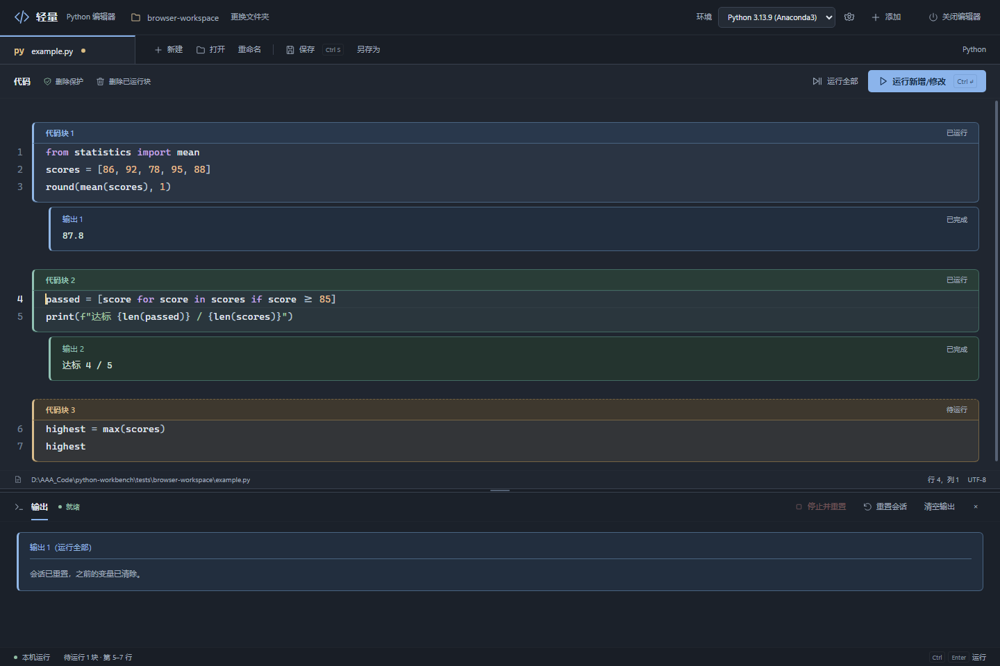

# 轻量 · Python 编辑器

离线浏览器界面，手动执行、保留变量，没有代码补全。后台仅使用 Python 标准库；网页编辑组件已随项目离线打包，日常运行不需要 Node 或联网。

界面采用紧凑的墨蓝工作台：文件标签与操作栏、Python 语法配色、当前行与括号提示，以及跟随代码的运行结果。代码优先使用本机 Cascadia Code 字体，未安装时使用 Consolas；界面不加载在线字体或图标。小屏窗口会重新排列操作按钮，窗口很矮时可滚动工作区访问输出与程序输入栏。

每个执行块都有独立的背景、边框与编号，相邻块使用不同的低饱和配色。“代码块 N”和“输出 N”同色对应，未运行的新增代码单独标记为“待运行”；修改后的块标记为“需重跑”。没有打印或回显的块也会显示“本块没有输出”。清空输出保留代码卡片，运行全部后整份代码作为一块，下方输出单独成卡。



## 启动

双击项目根目录的 **`PythonWorkbench.exe`**，会在电脑上的 **Google Chrome** 打开编辑器，不显示命令行窗口。EXE 直接启动 Python，启动器本身随即退出。请保留在完整的项目文件夹中；移动或重命名整个项目后，仍可直接双击其中的 EXE。

当前机器优先使用 `D:\Anaconda\Anaconda3\python.exe`，否则查找 PATH 中的 `python`。启动器会跳过 Windows 的空安装引导入口及不可用的解释器。启动环境需要 Python 3.10+ 和 Tkinter，EXE 不包含 Python 运行环境。

直接关闭最后一个编辑器标签页或浏览器窗口，约 3 秒后自动结束 Python 后台及执行进程；刷新页面会保留会话。也可使用网页右上角“关闭编辑器”立即退出全部会话。重复启动会复用当前后台，不再叠加后台进程。启动地址包含临时凭据，后台重启后需使用新地址。

## 使用

- **选择文件夹 → 新建 → 命名**：先选择工作文件夹，再点击“新建”输入文件名，确认后在该文件夹实际创建空文件；省略扩展名时补上 `.py`。取消或遇到重名、无效名称时不会切换当前文档。所选文件夹也是新文件的工作目录。更换文件夹不会清空当前代码；打开已有文件无需先选文件夹。
- **重命名**：文件栏的“重命名”修改实际文件名称，不覆盖同名文件；会话变量和编辑区未保存内容会保留。它不会自动保存未保存的代码，修改内容仍需 Ctrl+S。

- **Ctrl+Enter / 运行新增/修改**：范围由执行记录决定，与光标和选区无关。第一次从文件开头执行已写的代码；之后只执行上次成功执行末尾之后的新增部分。每次范围记为一个执行块，结果紧跟该块之后；赋值保持安静，块末尾的表达式回显结果。
- **修改已运行的代码**：修改最后一块时只重跑最后一块；修改前面的块时，从该块开始依次重跑后续已记录块，在各自原位置更新结果。都在点击运行时触发，变量保留。某块报错后暂停后续块，修正后重跑失败块；失败前的副作用不自动回滚。
- **已运行块的删除保护**：块内正常修改不受限制；没有选区时，Backspace / Delete 碰到已运行块末尾的分隔换行会停住。整块删除、剪切或粘贴覆盖，以及会删掉整块的撤销/重做，需要确认受影响的块数。光标放入已运行块后，可在代码工具栏点击“删除已运行块”。取消会保留代码和结果；确认后仍可撤销。清空输出、刷新页面保留保护，重置会话后解除。删除代码不会撤销已生成的变量，需要清除变量时请重置会话。
- **多行代码**：新增范围按完整 Python 代码执行，括号、列表、张量和函数/循环块不用逐行提交。若尚未写完整，会报告语法错误并保留该范围待重跑。需要临时只运行选区时，使用单独的“运行选区”按钮；临时选区不改变默认执行边界。
- **Enter 换行**：按 Python 语法层级决定缩进，每级 4 个空格。顶层语句结束、最外层括号闭合后，新行回到行首；括号内已有的续行沿用当前行的实际缩进，例如张量最后一行 `[0.22,0.8]` 后换行，与该行的 `[` 对齐。关闭内层括号后，如外层仍未结束，继续保持该层缩进；进入新的代码块或新括号层级时按语法缩进。匹配括号使用下划线提示，光标为醒目的 2 像素竖线。
- **运行全部**：先清空旧输出，再按脚本执行整个编辑区，结果显示在下方输出区，复用当前会话；成功后将整份代码记为一个执行块。脚本中的表达式不会自动显示，使用 `print()` 输出。
- **Ctrl+S / Ctrl+Shift+S**：保存 / 另存为。文件只保存 Python 代码，就地结果不写入文件。失败时不会清空编辑内容。已有文件保留编码和主要换行格式；新文件为 UTF-8，单文件上限 1 MB。
- **input()**：输出区下方出现输入栏，输入后按 Enter。第一版支持普通单行文本输入，不提供终端仿真、密码输入或键盘交互程序支持。
- **关闭底部输出栏**：点击输出栏右上角的“×”，代码区自动扩展；点击窗口底部“显示输出”重新打开，并恢复原来的分栏高度。关闭只隐藏面板，保留输出、代码和运行状态。运行全部或程序等待输入时会自动展开。
- **清空输出**同时清除就地结果和下方输出，保留变量和执行边界；**重置会话、停止并重置、切换解释器、新建或打开其他文件**清除变量及执行边界，下次从文件开头执行。停止会终止工作进程及其子进程。普通报错后可以继续执行，`exit()` 后需重置。保留会话时，删除代码不会自动删除此前创建的变量；需要干净环境时使用重置。
- **添加解释器**：自动检测本机 Python 安装、PATH、Windows 注册信息、Conda 环境和项目中的 `.venv` / `venv`，显示版本、来源和完整路径；点击“添加并使用”选择需要的环境。支持重新检测，也可通过“浏览文件…”手动选择 `python.exe`。检测只检查常见安装位置和环境记录，不扫描整个硬盘，非标准目录可能需要手动添加。可在齿轮按钮中管理和移除。解释器支持 Python 3.10+，依赖包由所选环境提供；编辑器不安装包。

主要面向电脑上的 Chrome，默认一次只开一个编辑页面。页面刷新时尝试从当前标签的会话存储恢复草稿；这不代替保存。重复打开页面且缺少有效草稿时，保存和运行会被禁用；在其他页面切换文件后，旧页面的保存请求也会被拒绝，防止覆盖错误的文件。新建文件使用选定的工作文件夹，已打开文件使用其所在目录作为工作目录。保存或另存为不会重置运行环境；如需更新执行文件名与工作目录，保存后重新打开文件。

输出保留最近约 1 MB 的后台事件、50 万字符的下方输出；每个就地结果最多保留最近 6.4 万字符，最多显示 100 个结果。刷新时会尝试从当前标签的草稿恢复最近的就地结果及运行位置，等待中的 `input()` 可继续提交。长时间运行的代码不会自动停止，请手动使用停止按钮。

## 修改界面

- `web/style.css`：顶部 `:root` 中调整颜色、字体和默认区域比例；其余规则控制布局。
- `web/index.html`：按钮、文字和页面结构。
- `web/app.js`：快捷键、编辑交互、输出显示与后台请求。直接修改后刷新页面，无需构建。
- `web/code-editor.js`：CodeMirror 编辑区和就地结果组件。修改此文件后运行 `npm ci`、`npm run build:editor`，更新 `web/vendor/code-editor.js`；已附带构建结果及第三方许可证，普通使用无需构建。
- `web/execution-history.mjs`：执行块边界、编辑后依赖重跑与刷新恢复；修改后同样需要重新打包。
- `web/block-layout.mjs`：代码与输出卡片的范围、编号和配色；修改后同样需要重新打包。
- `app.py`：文件选择和保存、本地 HTTP 接口。
- `session.py` / `worker.py`：解释器进程管理与交互执行。

启动器源码保存在 `scripts/Launcher.cs`。在 Windows PowerShell 中运行 `powershell.exe -NoProfile -ExecutionPolicy Bypass -File scripts/build-launcher.ps1`，会使用本机 .NET Framework C# 编译器重新生成 EXE 与多尺寸图标，无需安装额外编译工具。构建时会修正 EXE 可能从工作区继承的低完整性标记，确保以普通用户级别启动；仅处理生成的 EXE，原有访问权限保持不变。

如果在受管理工作区中克隆或重新检出项目后，EXE 无法自动打开浏览器，请重新运行上述启动器构建命令。

设置保存在本目录 `settings.json`。程序只监听 `127.0.0.1`，使用随机端口与临时令牌；运行的 Python 代码拥有当前用户的本机权限，请执行你信任的代码。

## 检查

```powershell
python -m unittest discover -s tests -v
node tests/test_execution_history.mjs
node tests/test_deletion_protection.mjs
node tests/test_block_layout.mjs
node --check web/app.js
```

浏览器验收使用隔离后台：先运行 `python tests/serve_browser_fixture.py`，再在另一终端设置 `$env:EDITOR_TEST_RUNNING = "$PWD/tests/.browser-running.json"` 并运行 `node tests/browser_smoke.mjs`。测试后台为系统选择框提供固定的项目内测试路径，不操作用户正在编辑的会话；脚本在独立 Chrome 测试配置中验证页面流程，并生成 `docs/editor-preview.png`。此验收脚本需要 Node 22+，编辑器本身不需要 Node。

Windows 启动器测试已包含在 Python 测试中，使用独立的中文、空格路径副本验证 EXE、无可见控制台、代码执行、重复启动、项目移动和关闭清理。

`python -m unittest discover -s tests -p test_launcher_browser.py -v` 进一步验证 EXE 自己自动打开真实 Chrome 页面，并等待页面回连后台；此检查不会由测试工具代替 EXE 打开页面。设置同一环境变量 `EDITOR_LAUNCHER_BROWSER_TEST=1` 后，还会在 EXE 已自动打开的页面上运行完整浏览器验收。

`--no-browser` 可取消自动打开页面；`--no-dialogs` 仅供无界面的后台测试使用，此模式无法使用本地文件选择框。
